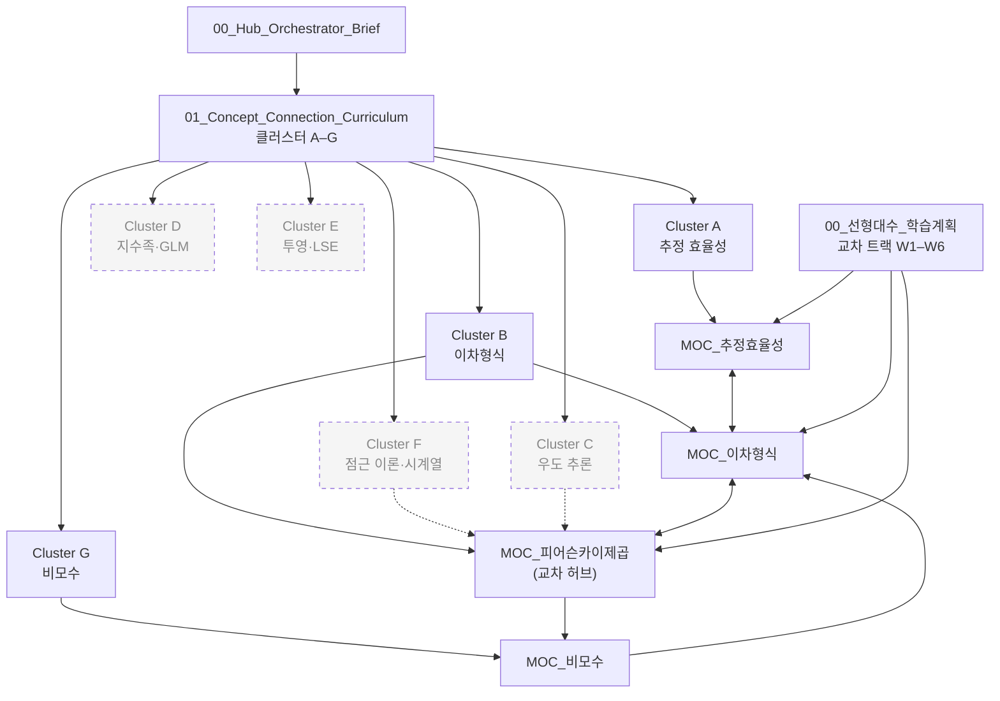

# 🧭 MOC 색인 — 모든 개념지도의 입구

> **이 노트의 역할**: 저장소 안의 **모든 MOC(Map of Content)** 를 한 표로 모은 입구.
> 사람이든 LLM 이든 "이 개념은 어디서 출발해 어디로 이어지는가"를 찾을 때 **여기서 시작**한다.

## 📖 이 저장소를 읽는 법 (LLM·사람 공통 입구)

1. **[[00_Hub_Orchestrator_Brief]]** — 학습 철학, 세션 워크플로, 챕터 → 클러스터 빠른 참조표.
2. **[[01_Concept_Connection_Curriculum]]** — 클러스터 A–G 의 개념 연결 사슬 (과목 경계를 넘는 뿌리).
3. **MOC (이 색인의 표)** — 클러스터 하나(또는 교차 지점)의 가지·학습 경로·교재 소재를 모은 허브.
4. **개별 노트** — `튜터워크스페이스/과목별/<과목>/` 의 정리노트·원자노트. 각 MOC 의 가지에서 들어간다.

- 현재 진도와 다음 출발점: [[00_Progress_Dashboard]]
- 교차 트랙: [[00_선형대수_학습계획]] — 선형대수 6주(W1–W6)가 Cluster E·B·A 의 행렬 도구를 공급. 도착점은 [[MOC_이차형식]] 가지 ⓪.
- 등록 규칙: [[_MOC자동등록_규칙]] (개념 통과 → MOC 가지에 등록 → 미연결 링크는 stub)

> [!tip] LLM 이 읽을 때
> 질문의 개념을 먼저 아래 표의 **핵심 개념** 열에서 찾고, 해당 MOC 의 「🌳 핵심 가지」→「📚 교재 소재」→「🔁 이어가기」 순으로 읽는다. MOC 의 `[[ ]]` 링크 중 일부는 아직 **stub(빈 노트)** 이므로, 파일이 없으면 MOC 본문의 설명을 근거로 삼는다.

---

## 🗂️ MOC 목록

| MOC | 클러스터 | 핵심 개념 | 상태 | 주요 연결 MOC |
|-----|----------|-----------|------|---------------|
| [[MOC_추정효율성]] | A | 불편성·Gauss-Markov(BLUE)·Aitken(GLS)·일반선형가설 F·Ridge 편의-분산 | 진행 — [[Aitken 정리]] 완결, 다수 stub | [[MOC_이차형식]] |
| [[MOC_이차형식]] | B | 선형대수 뿌리(멱등·rank = trace) → 이차형식 χ² → Cochran → SS 분해·F·ANOVA·회귀진단 | 진행 — 가지 ⑤(회귀진단) 노트 다수, 가지 ⓪ 2026-10-10 신설 | [[MOC_추정효율성]] · [[MOC_피어슨카이제곱]] · [[MOC_비모수]] |
| [[MOC_비모수]] | G | 순위·EDF → KS·Wilcoxon·Kruskal-Wallis → 부트스트랩 → 커널회귀 (K&V) | 골격 — 노드 0 / 7 | [[MOC_이차형식]] |
| [[MOC_피어슨카이제곱]] | B∩F∩C (교차 허브) | 다항 → 다변량 CLT → 특이 공분산(rank k−1) → χ²(k−1) → 적합도·독립성·G² | 골격 — 2026-10-10 생성 | [[MOC_이차형식]] · [[MOC_비모수]] |

> 상태 표기: **골격** = 가지 구조만 있고 노드 대부분 stub · **진행** = 일부 가지에 완성 노트 있음 · **완결** = 학습 경로 전체 통과.

---

## 🕸️ MOC ↔ 클러스터 지도

- 실선: MOC 본문에 직접 링크 · 점선: 클러스터 교차(전용 MOC 없음) · 회색 점선 테두리: **전용 MOC 가 아직 없는 클러스터**.

---

## ⬜ 빈칸 — 아직 MOC 가 없는 클러스터·과목

| 클러스터 / 과목 | 커리큘럼 핵심 사슬 | 지금 임시로 들르는 곳 |
|-----------------|-------------------|----------------------|
| **Cluster C** 우도 추론 | NP 보조정리 → UMP → LRT(Wilks) → F = LRT → GLM 추론 | [[MOC_피어슨카이제곱]] 가지 ⑥ (G²), [[01_Concept_Connection_Curriculum]] Cluster C |
| **Cluster D** 지수족·GLM | 지수족 → 정준연결 → GLM → 베이즈 켤레 | [[01_Concept_Connection_Curriculum]] Cluster D |
| **Cluster E** 투영·LSE | LIE → 정규방정식 → Hat Matrix → PCA·CCA | [[MOC_이차형식]] 가지 ②, [[00_선형대수_학습계획]] W1·W2·W5 · **임시 거처**: [[Ch02_LSE_정리노트_예시]] ([[MOC_추정효율성]] 가지 ① · [[MOC_이차형식]] 가지 ⓪ 에 연결) |
| **Cluster F** 점근 이론·시계열 | 확률수렴 → CLT·Delta → MLE 점근 → ARMA → 단위근(ADF) | [[MOC_피어슨카이제곱]] 가지 ②, [[점근 표기법 (Big-O, little-o, Op, op)]] |
| 다변량분석 (J&W) | MVN → Hotelling T² → MANOVA → PCA·요인분석 | [[00_선형대수_학습계획]] W5 |
| 범주형자료분석 (Agresti) | 다항표집 → 분할표 검정 → 대응쌍 | [[MOC_피어슨카이제곱]] (관련 노트: [[McNemar 검정]] · [[Cohen의 kappa (관측자 일치도)]]) |
| 베이즈통계 | (교재 미업로드) | — |

---

## ✍️ 유지 규칙

- **새 MOC 를 만들면 이 표에 한 줄 추가**하고, 위 mermaid 지도에 노드와 연결선을 넣는다. 빈칸 표에 있던 클러스터면 그 줄을 지운다.
- MOC 의 상태(골격 → 진행 → 완결)가 바뀌면 상태 열도 함께 고친다.
- **미연결(고아) 노트 점검**: `과목별/` 노트와 루트 원자노트가 최소 한 MOC 에 걸려 있는지 확인. 2026-10-10 점검 결과 **0개** (4개 연결 완료).
- 파일 이름은 `MOC_<개념>` 형식, 위치는 `튜터워크스페이스/MOC/`, frontmatter 에 `type: MOC` 와 `cluster:` 를 반드시 적는다.

## 🗓️ 기록
| 날짜 | 작업 |
|------|------|
| 2026-10-10 | 색인 생성 — MOC 4개 등록(A·B·G·B∩F∩C), 빈칸 클러스터 C·D·E·F 표시, 선형대수 교차 트랙 연결 |
| 2026-10-10 | 미연결 노트 4개 연결 — [[Ch02_LSE_정리노트_예시]] → 추정효율성 ①·이차형식 ⓪ / [[코시-슈바르츠 부등식]] → 추정효율성 ② / [[등분산성(homoscedasticity)]] · [[Levene 검정]] → 이차형식 ⑤ |
