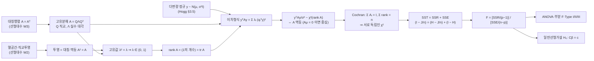

# 🗺️ MOC — [[이차형식]] (Quadratic Forms) · Cluster B

> **Map of Content**: 한 뿌리 개념에서 뻗어나간 가지를 한곳에 모으는 허브 노트.
> 학습자의 확장형 스타일을 위한 **백본(backbone)**. 어느 가지로 들어와도 이 노트를 거쳐 전체 맥락이 복원된다.

## 왜 이 클러스터가 백본인가 (매개중심성이 높은 이유)
이차형식 $Q = \mathbf{Y}^\top A \mathbf{Y}$는 **"제곱합(SS)"의 일반형**이다. 통계학의 거의 모든 *변동 분해·분포 이론·검정*이 이 한 형태로 환원된다.
- 회귀의 잔차제곱합, ANOVA의 각 SS, 검정통계량 분자/분모 — 전부 이차형식.
- 행렬 $A$가 **대칭·멱등(idempotent)** 이면 이차형식이 $\chi^2$ 분포를 따른다 → 검정의 토대.
- 그래서 이 노드는 *수리통계·회귀·실험설계*를 가로지르는 **매개중심성(betweenness)이 가장 높은 허브**. 여기를 잡으면 세 과목이 한 줄로 꿰인다.

---

## 🌳 핵심 가지 (Branches)

### ⓪ 선형대수 뿌리 — 행렬 도구에서 이차형식까지 (2026-10-10 신규)
> 🔗 **이 가지의 질문**: "왜 *멱등* 행렬만 $\chi^2$ 를 주고, 왜 자유도가 *trace* 로 세어지는가?" — 답은 전부 선형대수(대칭행렬의 고유분해, 투영)에 있다.
> 선형대수 트랙: [[00_선형대수_학습계획#📗 W2. 열공간·직교·투영 — Cluster E (B 교차)|선형대수 W2 (투영)]] → [[00_선형대수_학습계획#📗 W3. 고유값·대칭·멱등행렬 — Cluster B (현재 다음 초점)|선형대수 W3 (고유값·멱등)]]

**사슬 한 칸씩 — 어디서 오고 어디로 가는가**

| # | 개념 | 출발점 (선형대수) | 도착점 (통계) | 교재·노트 |
|---|------|------------------|---------------|-----------|
| 1 | 대칭행렬의 고유분해 $A=Q\Lambda Q^\top$ | 대칭 ⇒ 실수 고유값·정규직교 고유벡터 | $y^\top Ay=\sum_i\lambda_i(q_i^\top y)^2$: 이차형식 = **고유방향 좌표의 가중 제곱합** | 선형대수 W3 (혁펜하임 5-1~5-3강) · Hogg 다변량정규 부분(스펙트럼 분해, 절 번호 미확인) |
| 2 | 투영 = 대칭·멱등 | 열공간으로의 직교투영 $P$, $P^2=P$ | $H=X(X^\top X)^{-1}X^\top$, $I-H$ → 가지 ② | 선형대수 W2 (3-5강 정사영 행렬) · [[잔차의 직교성과 진단 그림의 가로축]] |
| 3 | 멱등 ⇒ 고유값 0/1, $\mathrm{rank}=\mathrm{tr}$ | $Av=\lambda v,\ A^2v=\lambda^2v$ ⇒ $\lambda^2=\lambda$ | **자유도 = trace**: $\mathrm{tr}(H)=p$, $\mathrm{tr}(I-H)=n-p$, $\mathrm{tr}(J/n)=1$ | 선형대수 W3 (3-4강 trace) · 김충락 §3.4 |
| 4 | $y\sim N(\mu,\sigma^2I)$ 하 $y^\top Ay/\sigma^2\sim\chi^2(\mathrm{rank}A)$ ⇔ $A$ 멱등 | 1·3을 합치면 $z=Q^\top y/\sigma$ 의 좌표 중 $r$개의 제곱합 | SSE, SSR 각각의 분포. $A\mu\neq0$ 이면 **비중심** $\chi^2$ (검정력의 출발점) | Hogg §3.5 (다변량정규) · Hogg §9.8 · 김충락 §3.4 (p114–119) |
| 5 | 독립성 · **Cochran 정리** | 직교 고유공간 분할: $A_iA_j=0$ ($i\neq j$) | $\sum A_i=I$, $\sum\mathrm{rank}A_i=n$ ⇒ 각 SS가 **서로 독립인** $\chi^2$ | Hogg §9.8–9.9 · [[이차형식의 분포와 독립성 (Cochran 정리)]] |
| 6 | $SST=SSR+SSE$ | $I-\tfrac1nJ=(H-\tfrac1nJ)+(I-H)$, 계수 $n-1=(p-1)+(n-p)$ | ANOVA 표의 SS·df 열이 곧 **행렬 분해와 trace** | 김충락 §3.3 (분산분석) · Hogg §9.2 |
| 7 | F 검정 · ANOVA · 일반선형가설 | 중첩 투영의 차 $P_{\text{full}}-P_{\text{reduced}}$ 도 멱등 | 전체 F, 부분 F, Type I/II/III, $H_0:C\beta=c$ | 김충락 §3.5–3.6 (F-검정), Ch5 (p.201–230) · [[Type I·II·III 제곱합과 부분 F-검정]] · [[일반선형가설의 F 통계량 도출]] |

- ⚠️ 표기: [[일반선형가설의 F 통계량 도출]] 은 $H_0:A\beta=c$ 로 쓰지만, 이 MOC 에서 $A$ 는 이차형식 행렬이라 여기서는 $C\beta=c$ 로 적는다 (같은 가설).
- 일반 공분산 확장: $y\sim N(\mu,\Sigma)$ 이면 조건이 "$A\Sigma$ 멱등"으로 바뀐다 — $\Sigma$ 의 양정치성·표백($\Sigma^{-1/2}$)이 필요 → [[00_선형대수_학습계획#📗 W4. 양의 정부호·역행렬 대각 — Cluster A·B|선형대수 W4]] · [[일반화최소제곱(GLS)]] (표백변환 $P'P=V^{-1}$).
- 같은 원리의 다른 얼굴: **피어슨 카이제곱**도 "정규벡터의 이차형식, 자유도 = 공분산(투영)행렬의 rank" → `[[MOC_피어슨카이제곱]]` (2026-10-10 신규).
- 행렬 랭크 도구: [[행렬 곱의 계수 부등식]] (rank 계산 보조).
- 사슬의 출발점(LSE): [[Ch02_LSE_정리노트_예시]] — 정규방정식 $X^\top X\beta=X^\top y$ 의 해 $\hat y=X\hat\beta$ 가 곧 열공간 투영 $Hy$ → 2번 칸(투영·멱등)의 입구. *(현재 예시 파일 — 실제 공부 후 교체; Cluster E 전용 MOC 생기기 전 임시 거처)* **(2026-10-10 연결)**

**선형대수 확인 과제 (W3 R 과제와 동일)**: `eigen(H)$values` 가 0/1 인지, `sum(diag(H))` = $p$ 인지, $I-H$ 와 $H-\tfrac1nJ$ 의 trace 가 SSE·SSR 자유도와 맞는지.

### ① 정의·분포 이론 (뿌리)
- [[이차형식]] — $\mathbf{Y}^\top A\mathbf{Y}$, 기댓값 $E[Q]=\mathrm{tr}(A\Sigma)+\mu^\top A\mu$
- [[이차형식의 분포와 독립성 (Cochran 정리)]] — 멱등·대칭 $A$ → $\chi^2$; 분해 SS들의 독립성 보증
- [[다변량 정규분포 — 二次형식과 독립성]] — Hogg §3.5, 정규성 하에서의 분포 유도

### ② 투영·멱등 행렬 (기하)
- [[Hat Matrix]] — $H=X(X^\top X)^{-1}X^\top$, **대칭·멱등** → 투영행렬
- [[Hat Matrix의 멱등성 및 대칭성]] — $H^2=H,\ H^\top=H$, $\mathrm{tr}(H)=p$ (자유도)
- [[LIE]] / [[투영]] — 조건부기댓값을 직교투영으로 보는 관점 (Cluster E와 교차)

### ③ 변동 분해 (ANOVA)
- [[ANOVA SS 분해]] — $SS_T=SS_{처리}+SS_{오차}$, 각 항이 멱등행렬 이차형식
- [[일원 ANOVA 제곱합 분해 — Hogg §9.2]] / [[이원 ANOVA와 교호작용 — Hogg §9.5]]
- [[F-검정]] — 두 독립 $\chi^2$의 비, Cochran 정리가 독립성 보장
- [[Type I·II·III 제곱합과 부분 F-검정]] — 회귀에서 SS를 **중첩 투영의 차**($P_{큰}-P_{작}$)로 쪼개는 세 방식; 부분 F = $t^2$ 동치, 전체 F검정 (Cluster B∩E∩A 매개 노드, ADP 기출 exam34 적용)
- [[Type II 제곱합 (정식화)]] — Type II를 **포함관계 격자**로 사영 정식화; 주변성 특성화, 순서무관성·($X_2$형) II=III 증명, Cochran으로 $F$ 유도
- [[Montgomery 불균형·공변량 ANOVA와 Type I·II·III]] — **불균형·공변량이 직교성을 깨면** Type이 갈리는 이유; Montgomery §15.2.3(exact method)·§15.3.4(공변량 요인실험), 김충락 3·5장 대응

### ④ 적용 — 반복측정으로의 확장 (오늘의 가지)
- [[반복측정 설계와 구형성 가정 (Mauchly 검정)]] — 개체 SS를 오차에서 추가 분리
- 잔차 직교 제약 $\sum_j e_{ij}=\sum_i e_{ij}=0$ → 자유도 $(n-1)(k-1)$가 **Cochran 정리**로 $\chi^2$ 분해됨
- 📄 연계 노트: [[Ch14_반복측정ANOVA_구형성_정리노트]]

### ⑤ 적용 — 회귀진단 잔차 가정 검정 (Ch4 가지)
- 잔차 벡터 $e=(I-H)y$, $\mathrm{Var}(e)=\sigma^2(I-H)$ — $I-H$ 가 **대칭·멱등**이라 잔차가 등분산·독립이 *아님*(검정 보정의 출발점)
- $SSE/\sigma^2 = y^\top(I-H)y/\sigma^2 \sim \chi^2_{n-p}$ — 멱등 이차형식의 분포, **Cochran 정리**로 보증 → [[이차형식과 Cochran 정리]]
- **Durbin–Watson** $d=\dfrac{e^\top A e}{e^\top e}$ — 독립성 검정통계량이 **두 이차형식의 비**(차분행렬 $A$), F·DW가 같은 이차형식-비 골격을 공유
- [[잔차의 직교성과 진단 그림의 가로축]] — 같은 대칭·멱등성으로 $\hat y^\top e=0$, $y^\top e=e^\top e=SSE$; 진단 그림 가로축이 $\hat y$ 여야 하는 이유(가로축 $y$ 면 기울기 $1-R^2$ 의 가짜 우상향) **(2026-08-02 신규)**
- 📄 연계 노트: [[잔차 가정 검정 (정규성·등분산성·독립성)]] (= [[Ch04_잔차가정검정_백지유도]])
- [[등분산성(homoscedasticity)]] — $\mathrm{Cov}(\varepsilon)=\sigma^2I$ 의 **대각 조건**. 깨지면 $SSE/\sigma^2\sim\chi^2_{n-p}$ 와 F검정의 전제가 무너진다 → [[Breusch-Pagan 검정]]으로 진단, GLS/WLS 로 처방. *(빈 stub — 본문 미작성)* **(2026-10-10 연결)**
- [[Levene 검정]] — 집단 간 등분산성 검정: 편차 절댓값 $|Y_{ij}-\bar Y_{i\cdot}|$ 에 **일원 ANOVA F** 를 적용 → 이 MOC 의 SS 분해·F 기계를 그대로 재사용 ([[Ch14_반복측정ANOVA_구형성_정리노트]] between 가정 점검에서 사용). *(빈 stub — 본문 미작성)* **(2026-10-10 연결)**
- 📄 실전 적용: [[Ch04_ADP32_Boston_회귀가정검토]] — ADP 32회 문제3, Boston 4가지 가정 전수 검정 (전부 위배)

---

## 🧭 권장 학습 경로 (뿌리 → 잎)
0. ⓪ 선형대수 뿌리 ([[00_선형대수_학습계획|선형대수]] W2 투영 → W3 고유값·멱등, rank = trace) → 1. [[이차형식]] 정의·기댓값 → 2. [[이차형식의 분포와 독립성 (Cochran 정리)]] → 3. [[Hat Matrix]] 멱등·대칭 → 4. [[ANOVA SS 분해]] → 5. [[F-검정]] 독립성 → 6. [[반복측정 설계와 구형성 가정 (Mauchly 검정)]] (확장)

> 한 바퀴 돌면: "왜 멱등이면 고유값이 0/1이고 자유도가 trace인가 → 왜 SS가 $\chi^2$인가 → 왜 F검정이 성립하는가 → 왜 반복측정이 더 예리한가"가 **하나의 논리**로 연결된다.

## 🔗 다른 클러스터와의 교차점
- **Cluster A (추정효율성)**: [[Gauss-Markov 정리]]의 BLUE 증명에 이차형식 최소화가 등장 → `[[MOC_추정효율성]]` (생성됨). 일반선형가설 F검정의 분자·분모가 이차형식이라 두 허브가 맞물린다.
- **Cluster E (투영·LSE)**: [[Hat Matrix]]는 두 클러스터의 공유 노드 → 투영 관점
- **다변량**: [[Wishart 분포와 표본공분산행렬의 분포]] — 이차형식의 행렬판 일반화
- **선형대수 트랙**: [[00_선형대수_학습계획]] W2(투영)·W3(고유값·멱등)이 가지 ⓪의 왼쪽 절반, W4(양의 정부호)가 $\Sigma\neq\sigma^2I$ 확장 → 이 MOC가 선형대수 6주의 **도착점**.
- **피어슨 카이제곱 (Cluster B∩F∩C)**: 다항분포 → 다변량 CLT → 특이 공분산(rank $k-1$) → 일반화역행렬 이차형식 → $\sum(O-E)^2/E\sim\chi^2_{k-1}$. "자유도 = 투영행렬의 rank"가 정규선형모형 밖에서도 성립하는 예 → `[[MOC_피어슨카이제곱]]`.

## 📚 교재 소재 (cross-textbook)
- Hogg 8판 §9.8–9.9 (이차형식 분포·Cochran), §9.2·§9.5 (ANOVA 분해)
- 김충락 회귀분석 Ch3–4 (Hat Matrix, 이차형식 — 회귀 맥락) — 세부: **§3.3 분산분석, §3.4 이차형식과 제곱합의 분포 (p114–119; 3.4.1 제곱합의 이차형식, 3.4.2 적합값의 분포), §3.5–3.6 F-검정**, Ch5 일반선형가설 (p.201–230)
- Hogg 8판 §3.5 (다변량 정규 — 가지 ⓪의 분포 가정)
- 선형대수: 혁펜하임 「"보이는" 선형대수학」 W2(2-3·2-6·2-7·3-5·4-3·9-1·9-2강), W3(3-3·3-4·5-1~5-3강) — 멱등행렬 단독 강의는 없음 → 김충락 §3.4·Hogg §9.8로 보충
- Montgomery 8판 §3 (일원 ANOVA 분해), §14 (반복측정)

---

## 🔁 이어가기 — 2026-10-10 세션 (미연결 노트 연결)
1. **대상**: [[00_MOC_색인]] 신설 시 고아 점검 → 미연결 노트 3개를 이 MOC 에 등록
2. **오늘 한 것**: 가지 ⓪에 [[Ch02_LSE_정리노트_예시]] (LSE = 투영의 출발점), 가지 ⑤에 [[등분산성(homoscedasticity)]] · [[Levene 검정]] (가정 검정) 연결. 노트 파일 이동·이름 변경 없음
3. **핵심 상태**: [[등분산성(homoscedasticity)]] · [[Levene 검정]] 은 저장소 루트의 **빈 파일(0 byte)** — 본문 작성 필요. [[Ch02_LSE_정리노트_예시]] 는 예시 템플릿
4. **다음 출발점** →: 가지 ⑤ 백지유도 시 등분산성 원자노트 본문 작성 (BP 검정·Levene 를 같은 'σ² 가 일정한가' 질문으로 묶기)
5. **연결**: [[00_MOC_색인]] · [[MOC_추정효율성]]

## 🔁 이어가기 — 2026-10-10 세션 (선형대수 뿌리 가지)
1. **대상**: `[[MOC_이차형식]]` 가지 ⓪ 신설 · 선형대수 트랙 W2·W3 ↔ Cluster B 연결
2. **오늘 한 것**: 대칭행렬 고유분해 / 투영·멱등(고유값 0·1, rank = trace) → $y\sim N(\mu,\sigma^2I)$ 하 $y^\top Ay/\sigma^2\sim\chi^2(\mathrm{rank}A)$ ⇔ 멱등 → Cochran → $SST=SSR+SSE$ → F·ANOVA·일반선형가설 사슬을 mermaid 지도 + 7칸 연결표로 정리. 교차 MOC `[[MOC_피어슨카이제곱]]` 신규 생성과 상호 링크
3. **핵심 상태**: 지도(골격)만. 백지유도는 미착수 — 선형대수 W3 핵심 질문 1–3과 동일
4. **다음 출발점** →: 대시보드 확정 출발점 `[[이차형식]]` (김충락 §3.4) 백지유도 시 가지 ⓪의 3·4번 칸(멱등 ⇒ 고유값 0/1 ⇒ $\chi^2$ 자유도)부터
5. **연결**: `[[00_선형대수_학습계획]]` · `[[MOC_피어슨카이제곱]]` · `[[Type I·II·III 제곱합과 부분 F-검정]]`

## 🔁 이어가기 — 2026-08-02 세션
1. **대상**: `[[잔차의 직교성과 진단 그림의 가로축]]` (신규 원자노트) · 가지 ⑤ 회귀진단 · 트랙 A
2. **오늘 한 것**: $H$ 의 대칭·멱등성으로 $\hat y^\top e=0$ / $y^\top e=e^\top e$ 유도 완결 → `plot(lm)` 가로축 문제 해결. ADP 32회 Boston 데이터로 4가지 가정 전수 검정(전부 위배) 및 수치 검증
3. **핵심 상태**: 원자노트 완결. 적용노트 `[[Ch04_ADP32_Boston_회귀가정검토]]` 는 **문제 1만 완료**, 문제 2(VIF·다중공선성)·3(구현) 미착수
4. **다음 출발점** →: `[[Ch04_ADP32_Boston_회귀가정검토]]` 열린 질문 Q1(DW를 순서 없는 데이터에 적용하는 문제) 해결 후 [[분산팽창인자(VIF)]] 로 진입
5. **연결**: `[[Ch04_잔차가정검정_백지유도]]` · `[[Durbin-Watson 검정]]` · `[[분산팽창인자(VIF)]]`

## 🔁 이어가기 — 2026-06-11 세션
1. **대상**: `[[MOC_이차형식]]` 허브 노트 신규 생성 · 트랙 A 인프라
2. **오늘 한 것**: Cluster B 백본 MOC 구축 — 4개 가지(분포·투영·ANOVA·반복측정)와 학습경로 연결
3. **핵심 상태**: 골격 완성. 각 `[[ ]]` 노드 중 다수가 아직 **빈 노트(stub)** — 다음 세션에 개별 원자노트 채워야 함
4. **다음 출발점** →: 학습경로 1번 [[이차형식]] 정의·기댓값 원자노트부터 작성, 또는 [[이차형식의 분포와 독립성 (Cochran 정리)]] 유도
5. **연결**: `[[Ch14_반복측정ANOVA_구형성_정리노트]]` · `[[MOC_추정효율성]]`(예정)
