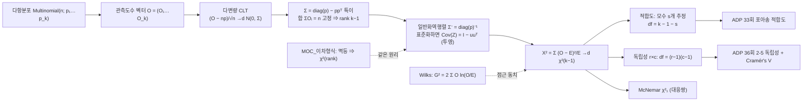

# 🗺️ MOC — [[피어슨 카이제곱 검정]] (Pearson's Chi-square) · Cluster B∩F∩C (교차 허브)

> **Map of Content**: "$\sum (O-E)^2/E$ 는 어디서 왔고, 왜 자유도가 칸 수 $k$ 가 아니라 $k-1$ (또는 $k-1-s$, $(r-1)(c-1)$) 인가"라는 한 뿌리에서 뻗어나간 가지를 모으는 허브.
> 이 MOC 는 클러스터 하나에 속하지 않는 **교차 허브**다 — 분포의 뼈대는 Cluster B(이차형식), 근사의 근거는 Cluster F(점근), 짝 검정($G^2$)은 Cluster C(우도비).

> [!note] 상태: 골격(skeleton)
> 2026-10-10 골격 생성. 아래 `[[ ]]` 노드 중 **이미 있는 노트**는 [[McNemar 검정]] · [[Cohen의 kappa (관측자 일치도)]] · [[점근 표기법 (Big-O, little-o, Op, op)]] · [[Breusch-Godfrey 검정]] · [[Breusch-Pagan 검정]] 뿐이고, 나머지는 stub 예정 — [[_MOC자동등록_규칙]]에 따라 개념 통과 시점에 채운다.

## 왜 이 클러스터가 백본인가 (매개중심성이 높은 이유)
피어슨 통계량은 겉보기엔 "칸별 차이의 제곱을 기대빈도로 나눈 합"이지만, 속은 **정규벡터의 이차형식**이다.
- 정규선형모형의 $SSE/\sigma^2\sim\chi^2_{n-p}$ 와 **같은 원리**: 자유도 = 공분산(투영)행렬의 rank → `[[MOC_이차형식]]` 가지 ⓪.
- 다만 정확분포가 아니라 **점근**분포: 다항분포 → 다변량 CLT → 극한에서만 $\chi^2$ → Cluster F.
- 같은 가설을 우도비로 재면 $G^2$, 점수(score)로 재면 피어슨 $X^2$ → 둘이 점근적으로 같다 → Cluster C ([[Breusch-Godfrey 검정]]·[[Breusch-Pagan 검정]]의 $nR^2$ 도 같은 LM/score 계열).
- 그래서 이 노드는 *수리통계(다항·CLT) · 선형대수(일반화역행렬·투영) · 범주형자료분석 · ADP 실기*를 한 줄로 꿴다.

---

## 🗺️ 전체 지도

---

## 🌳 핵심 가지 (Branches)

### ① 출발점 — 다항분포와 관측도수 벡터 (뿌리)
- [[다항분포]] — $O\sim\text{Multinomial}(n;p)$, $E[O]=np$, $\mathrm{Cov}(O)=n(\mathrm{diag}(p)-pp^\top)$. 각 칸은 이항, 칸끼리는 **음의 상관** (합이 $n$ 으로 묶여 있으므로).
- 연결: [[McNemar 검정]] 과 [[Cohen의 kappa (관측자 일치도)]] 도 같은 다항표집 위에서 출발 (기존 노트, Agresti 3e Ch11).
- 교재: Hogg 8판 다항분포 부분 (절 번호 미확인 — 아래 「교재 소재」 참고).

### ② 근사 — 다변량 CLT (Cluster F)
- [[다변량 중심극한정리]] — $O=\sum_{j=1}^n W_j$ ($W_j$ = 원-핫 벡터, iid) 이므로 $(O-np)/\sqrt n\xrightarrow{d}N_k(0,\ \mathrm{diag}(p)-pp^\top)$.
- 1차원 CLT (Hogg §5.3) 의 벡터판. 수렴 차수·$o_p$ 다루기 → [[점근 표기법 (Big-O, little-o, Op, op)]] (기존 노트).
- "기대빈도 ≥ 5" 규칙 = 이 정규근사가 쓸 만해지는 경험적 조건.

### ③ 선형대수 — 특이 공분산과 일반화역행렬 (Cluster B, 핵심 가지)
- [[특이 공분산과 일반화역행렬]] — $\Sigma=\mathrm{diag}(p)-pp^\top$ 는 $\Sigma\mathbf 1=p-p(\mathbf 1^\top p)=0$ ⇒ **특이**, $\mathrm{rank}\,\Sigma=k-1$.
- $\mathrm{diag}(p)^{-1}$ 이 $\Sigma$ 의 **일반화역행렬**: $\Sigma\,\mathrm{diag}(p)^{-1}\Sigma=\Sigma$ ⇒ $X^2=(O-np)^\top[n\,\mathrm{diag}(p)]^{-1}(O-np)=\sum(O_i-E_i)^2/E_i$.
- 투영 관점: $Z_i=(O_i-E_i)/\sqrt{E_i}$, $u=(\sqrt{p_1},\dots,\sqrt{p_k})^\top$ ⇒ $H_0$ 하 $\mathrm{Cov}(Z)=I_k-uu^\top$ = **대칭·멱등**, $\mathrm{rank}=\mathrm{tr}=k-1$.
- 정리: $Z\sim N_k(0,P)$, $P$ 멱등 ⇒ $Z^\top Z\sim\chi^2_{\mathrm{rank}P}$ — `[[MOC_이차형식]]` 가지 ⓪ 3·4번 칸과 **같은 정리**.
- 선형대수 트랙: [[00_선형대수_학습계획#📗 W2. 열공간·직교·투영 — Cluster E (B 교차)|W2 투영]] · [[00_선형대수_학습계획#📗 W3. 고유값·대칭·멱등행렬 — Cluster B (현재 다음 초점)|W3 멱등·rank = trace]] · [[00_선형대수_학습계획|W6 의사역행렬 (6-4강)]].

### ④ 통계량 — $X^2=\sum(O-E)^2/E\xrightarrow{d}\chi^2_{k-1}$ (줄기)
- [[피어슨 카이제곱 검정]] — 단순가설 $H_0:p=p_0$ (모수 추정 없음) 에서 df $=k-1$.
- 자유도 공식의 일반 원리: **df = (전체 차원) − (제약·적합에 쓴 차원)** = 잔차 투영행렬의 rank. OLS 의 $n-p$ 와 같은 구조.

### ⑤ 적용 — 적합도와 독립성 (잎)
- [[카이제곱 적합도 검정]] — 모수 $s$ 개를 추정하면 $P^*=I-uu^\top-B(B^\top B)^{-1}B^\top$, df $=k-1-s$. (모수 추정 = 그 방향으로 잔차를 0으로 미는 추가 투영)
  - ⚠️ Chernoff–Lehmann: 모수를 **원자료**(구간화 전)로 추정하면 극한분포가 $\chi^2_{k-1-s}$ 와 $\chi^2_{k-1}$ **사이**.
  - 분포무관 대안(연속형): KS 검정 → `[[MOC_비모수]]` 가지 ② (K&V Ch6).
- [[카이제곱 독립성 검정]] — $r\times c$ 표, $H_0:p_{ij}=p_{i+}p_{+j}$. 추정 모수 $(r-1)+(c-1)$ 개 ⇒ df $=(rc-1)-(r-1)-(c-1)=(r-1)(c-1)$.
  - 효과크기 [[Cramér's V]] $=\sqrt{X^2/\{n(\min(r,c)-1)\}}$ — $X^2$ 는 $n$ 에 비례해 커지므로 **유의성 ≠ 효과크기**.
  - 대응쌍(같은 개체 두 번)이면 독립성 검정이 아니라 [[McNemar 검정]] ($\chi^2_1$).

### ⑥ 짝 검정 — 우도비 $G^2$ 와 Wilks 정리 (Cluster C)
- [[우도비 검정 (LRT) 과 점근 카이제곱 분포]] — $G^2=-2\log\Lambda=2\sum O_i\ln(O_i/E_i)\xrightarrow{d}\chi^2$ (같은 df).
- $\ln(1+x)$ 2차 테일러 전개로 $G^2-X^2\xrightarrow{p}0$ ⇒ **점근 동치**. 피어슨 $X^2$ 는 다항모형의 **score 검정**, $G^2$ 는 **LRT** — 대표본에서 Wald·Score·LRT 가 같아지는 Cluster F 의 사례.
- GLM 의 residual deviance 가 곧 $G^2$ → 포아송 과산포 진단과 연결.

---

## 🧭 권장 학습 경로 (뿌리 → 잎)
1. [[다항분포]] 평균·공분산 → 2. [[다변량 중심극한정리]] → 3. [[특이 공분산과 일반화역행렬]] (선형대수 W2·W3 이후 권장) → 4. [[피어슨 카이제곱 검정]] df $=k-1$ → 5. [[카이제곱 적합도 검정]] (df $-s$) → 6. [[카이제곱 독립성 검정]] + [[Cramér's V]] → 7. [[우도비 검정 (LRT) 과 점근 카이제곱 분포]] ($G^2$ 동치).

> 한 바퀴 돌면: "칸 도수는 다항이다 → 대표본에서 정규다 → 그런데 합이 묶여서 공분산이 특이하다 → 그래서 자유도는 rank $k-1$ 이다 → 모수를 추정할 때마다 rank 가 깎인다"가 **하나의 논리**로 연결된다. 이것은 `[[MOC_이차형식]]` 의 "멱등 ⇒ $\chi^2$(rank)" 의 다항판이다.

## 🔗 다른 클러스터와의 교차점
- **Cluster B (이차형식)**: 가지 ③이 `[[MOC_이차형식]]` 가지 ⓪(멱등 ⇒ 고유값 0/1 ⇒ rank = trace ⇒ $\chi^2$)과 같은 정리. OLS $y^\top(I-H)y$ ↔ GOF $Z^\top P^*Z$ 대응표는 Rprojects 개념노트 부록 A-5.
- **Cluster F (점근이론)**: 가지 ②(다변량 CLT)와 ⑥(Wald·Score·LRT 대표본 동치) → [[01_Concept_Connection_Curriculum#📌 Cluster F — 점근 이론 (Asymptotic Theory)|커리큘럼 Cluster F]] (Cluster F 전용 MOC 는 아직 없음).
- **Cluster C (우도 추론)**: $G^2$ = Wilks 의 LRT → [[01_Concept_Connection_Curriculum#📌 Cluster C — 우도 기반 추론 (Likelihood-Based Inference)|커리큘럼 Cluster C]] ("t·F·카이제곱 검정은 모두 같은 원리인가?"). 같은 LM/score 계열: [[Breusch-Godfrey 검정]] · [[Breusch-Pagan 검정]] ($nR^2\to\chi^2$).
- **Cluster G (비모수)**: 연속형 적합도는 KS·AD (EDF 계열) → `[[MOC_비모수]]`.
- **범주형자료분석**: [[McNemar 검정]] · [[Cohen의 kappa (관측자 일치도)]] (다항표집 공유).

## 🧪 실전 적용 (ADP 실기 — Rprojects 저장소)
- **33회 4-1 포아송 적합도** — `Rbasics/ADP_Training_Center/개념노트_분포적합도검정.md` (Rprojects)
  - 지하철 1호선 일일 연착 횟수, $n=50$, $\hat\lambda\approx7.82$, 기대빈도 < 5 꼬리 병합 → 6구간, $X^2=2.057$, df $=6-1-1=4$, $p\approx0.725$.
  - 가지 ⑤의 df $-s$ 와 Chernoff–Lehmann 단서가 그대로 등장. `chisq.test()` 는 df 를 $k-1$ 로 계산하므로 p-value 를 `pchisq()` 로 다시 구해야 함.
  - 그 노트 부록 A(이차형식·사영·rank)가 이 MOC 가지 ③의 손풀이 버전.
- **36회 2-5 독립성 검정 + Cramér's V** — `Rbasics/ADP기출문제모음/36회_기출_문제.ipynb` (Rprojects), 데이터 `user_info.csv`·`user_log.csv`
  - favorite_category × churn, 고객 수 5명 미만 범주는 `Other` 로 병합, `correction=False` (Yates 보정 없음), Cramér's V 와 기대빈도 < 5 셀 비율 보고, **유의성과 효과크기 구분** 해석.
  - 가지 ⑤: df $=(r-1)(c-1)$, 범주 병합은 가지 ②의 정규근사 조건(기대빈도) 때문.
  - 데이터 함정: 로그 없는 150명의 범주를 'None' 으로 둘지가 $r$ 을 바꿈 → df 와 Cramér's V 분모가 같이 바뀜.

## 📚 교재 소재 (cross-textbook)
- **Hogg 8판** (저장소 텍스트로 확인된 절만 번호 표기)
  - §5.3 CLT (1차원) · §5.2.2 Δ-method — 가지 ②
  - §6.3, §6.5 우도비 검정과 점근 카이제곱 (대시보드) / §8.3 (커리큘럼) — 가지 ⑥
  - §3.5 다변량 정규 — 가지 ③의 극한분포
  - §9.8–9.9 이차형식 분포·Cochran — 가지 ③의 정리
  - 절 번호 **미확인** (주제명만): 다항분포, 다변량 CLT, 카이제곱 적합도·독립성 검정 (Rprojects 개념노트는 "Hogg Ch 4·6" 으로 인용 — 장 수준만)
- **Agresti**, *Categorical Data Analysis* 3e — 이원분할표의 독립성 검정·$X^2$ 와 $G^2$ 부분 (절 번호 미확인; 저장소는 Ch11 대응쌍만 확인)
- **K&V** Ch6 (적합도: KS·Smirnov) — 연속형 대안
- **선형대수**: [[00_선형대수_학습계획]] W2·W3·W6 (혁펜하임 3-5강 정사영 행렬, 3-4강 trace, 6-4강 의사역행렬)

---

## 🔁 이어가기 — 2026-10-10 세션 (골격 생성)
1. **대상**: `[[MOC_피어슨카이제곱]]` 교차 허브 신규 생성 · Cluster B∩F∩C
2. **오늘 한 것**: 다항 → 다변량 CLT → 특이 공분산(rank $k-1$) → 일반화역행렬·투영 이차형식 → $X^2\to\chi^2_{k-1}$ → 적합도(df $-s$)·독립성($(r-1)(c-1)$) → $G^2$ 점근 동치 사슬을 mermaid 지도 + 6개 가지로 정리. ADP 33회 포아송 적합도·36회 2-5 독립성 검정 연결. `[[MOC_이차형식]]` 가지 ⓪과 상호 링크
3. **핵심 상태**: 골격만. 가지 노드 대부분 미생성(stub 예정), 통과 개념 0 / 7
4. **다음 출발점** →: 선형대수 W3 이후 가지 ③ [[특이 공분산과 일반화역행렬]] 백지유도 ($\Sigma\,\mathrm{diag}(p)^{-1}\Sigma=\Sigma$ 확인부터), 또는 36회 2-5 실습 시 가지 ⑤
5. **연결**: `[[MOC_이차형식]]` · `[[00_선형대수_학습계획]]` · `[[01_Concept_Connection_Curriculum]]` (Cluster C·F)
